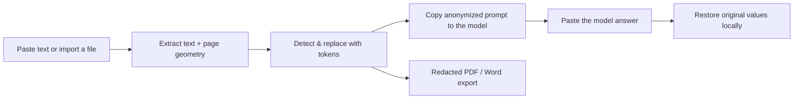

# NullLM

**Local PII & sensitive data anonymizer for LLM prompts.**

Paste a contract, a server log or a database dump and NullLM swaps sensitive values for tokens
(`[PESEL_1]`, `[EMAIL_1]`, `[IP_ADDRESS_1]`, `[KWOTA_A]`, …). Send the anonymized prompt to any
model, paste the answer back, and restore the original values locally.

> **Rule #1 — nothing leaves the browser.**
> No backend, no telemetry, no third-party API. Text extraction, detection, document previews and
> PDF/Word export all run on your device. The app never sends your text anywhere.



---

## Table of contents

- [Quick start](#quick-start)
- [Features](#features)
- [How PDF redaction works](#how-pdf-redaction-works)
- [Detection rules](#detection-rules)
- [Plans (mock licensing)](#plans-mock-licensing)
- [Privacy & security model](#privacy--security-model)
- [Tech stack](#tech-stack)
- [Project structure](#project-structure)
- [Scripts](#scripts)
- [Limitations](#limitations)
- [Third-party notices](#third-party-notices)

---

## Quick start

### Windows — one click

Double-click **`start.cmd`**. It finds Node.js (PATH or the portable install in
`%LOCALAPPDATA%\Programs\nodejs`), runs `npm install` on the first launch, starts the dev server and
opens <http://localhost:5173>.

### Manual

```bash
node --version   # Node.js 20+ (tested on 22.x)
npm install
npm run dev      # http://localhost:5173
```

Production build:

```bash
npm run build    # tsc --noEmit && vite build
npm run preview  # serve dist/
```

---

## Features

### 1. Three-step workflow

| Panel | What it does |
| --- | --- |
| **1 · Source text** | Paste anything or drop a file. Live word/character counters, free-plan limit, drag & drop. |
| **2 · Anonymized prompt** | Tokenized text with highlighted tokens, one-click **Copy**, document preview, export. |
| **3 · Restore** | Paste the model's answer and turn tokens back into the original values. |

Tokens are deterministic inside a session — the same value always gets the same token
(`[EMAIL_1]` stays `[EMAIL_1]`), so the model can reason about it consistently. Amounts use
alphabetic suffixes (`[KWOTA_A]`, `[KWOTA_B]`).

The deanonymizer is tolerant of formatting damage: `[PESEL_1]`, `[PESEL 1]`, `【PESEL-1】`,
`(pesel_1)` and a bare `pesel_1` are all restored. Missed tokens and unknown tokens are reported.

### 2. Mapping table

Below the editor: original value · data type · generated token · actions. Tokens can be renamed
(validated for uniqueness and charset), mappings removed, and the whole session cleared with one
button. The table can also be exported as JSON (Pro).

### 3. Files: import and real previews

| Format | Reader | Preview |
| --- | --- | --- |
| `.txt`, `.log`, `.md`, `.csv`, `.json` | `TextDecoder` (UTF-8 → cp1252 fallback) | text |
| `.docx` | `fflate` + `word/document.xml` (drops tracked changes and field codes) | rendered document via `docx-preview` |
| `.pdf` | `pdf.js` (text + per-item geometry, page count) | real pages rendered to `<canvas>` with page navigation and zoom |
| `.doc` (Word 97-2003) | heuristic UTF-16LE / cp1252 | text (with a warning) |

Files are capped at 10 MB and are read with `File.arrayBuffer()` — nothing is uploaded.

### 4. PDF export with true in-place redaction

Exporting an imported PDF **does not rebuild the document**. The original page content is kept and
the sensitive spans are painted over with opaque boxes plus white token labels, so layout, tables,
fonts, images and page count stay identical.

- Positions come from the `pdf.js` text layer (per-item origin, size and width) and are refined
  with font metrics, so the box covers exactly the matched value.
- **Encrypted PDFs** — e.g. documents signed on Autenti/DocuSign protected with AES-256 — are
  decrypted in memory first (standard security handler, V5/R5–R6, empty user password). The
  exported file is a regular vector PDF with selectable text.
- **Encrypted/unsupported corner cases** fall back to rasterizing the pages automatically, and the
  UI tells you that it happened.
- **Manual marking** for content that is not text: scanned signatures, stamps, name plates. In the
  document preview, enable *Mark an area to hide* and drag a rectangle, or hit *Redact whole page*.
  The boxes are applied to every export format.
- **Remove the hidden text layer** (optional checkbox): rasterizes the pages so the original glyphs
  are gone from the file and cannot be copy/pasted or extracted with a PDF text tool.
- The preview dialog shows the **actual PDF that will be saved**, not an approximation.

### 5. Word export

When the source is a PDF, the `.docx` is built so that it looks **1:1 like the PDF**: every page is
rendered with the redactions applied and embedded as a full-page image, inside an A4 section with
zero margins. Nothing re-flows, no table breaks. The Word file also contains no hidden text layer.

For plain-text sources the DOCX is generated as a normal WordprocessingML document.

### 6. Multi-language UI and rules

The whole interface is available in **Polish, English and German**. The language also drives the
detection filters: Polish IDs (PESEL, NIP, ID card), German IDs (USt-IdNr, Steuer-ID) and English
ones (SSN, NINO) are shown only where they make sense, while universal rules (e-mail, IP, API keys,
IBAN, amounts, names…) are always available.

Rules hidden by the language filter are still evaluated in the background: if they would have
matched, panel 2 shows a warning ("N fragments outside the language filter") with a
**Show all regions** shortcut — useful for documents written in another language than the UI.

---

## How PDF redaction works

1. **Extract** — `pdf.js` returns text items with their position, size and width. NullLM normalizes
   the text exactly like the editor does and keeps a map from every normalized character back to its
   page/item/character origin (`src/lib/files/pdf.ts`).
2. **Plan** — token offsets are translated into rectangles per text item. Proportional positions are
   computed with Helvetica metrics (a close proxy for typical document fonts) with a small safety
   margin (`src/lib/files/pdfGeometry.ts`).
3. **Decrypt if needed** — AES-256 encrypted documents are decrypted in memory: the file key is
   derived from the empty user password, validated against `/U`, all streams and hex strings are
   decrypted and `/Encrypt` is dropped (`src/lib/files/pdfDecrypt.ts`, `src/lib/crypto/aes.ts`).
4. **Draw** — `pdf-lib` appends opaque boxes and token labels to the original page content
   (`src/lib/files/pdfRedact.ts`).
5. **Optional flattening** — `src/lib/files/pdfRender.ts` renders each page with the boxes painted
   on a canvas; `pdfFlatten.ts` rebuilds an image-only PDF and `docxFromPdf.ts` builds the Word file
   from those same page images.

---

## Detection rules

25 modular rules. Each rule declares its region, category, plan tier and priority; overlaps are
resolved by start position, then priority, then match length.

| Rule | Token | Validation | Plan |
| --- | --- | --- | --- |
| PESEL (PL) | `[PESEL_1]` | checksum + birth date | Pro |
| NIP (PL) | `[NIP_1]` | checksum (mod 11), optional `PL` prefix | Pro |
| Polish ID card | `[DOWOD_1]` | 3 letters + 6 digits | Pro |
| Bank account / IBAN | `[KONTO_1]` | 26 digits + IBAN mod-97 | Pro |
| USt-IdNr (DE) | `[UST_ID_1]` | ISO 7064 MOD 11,10 | Pro |
| Steuer-ID (DE) | `[STEUER_ID_1]` | ISO 7064 MOD 11,10 | Pro |
| SSN (US) | `[SSN_1]` | area/group/serial | Pro |
| NINO (UK) | `[NINO_1]` | prefix + suffix | Pro |
| Payment card | `[KARTA_1]` | Luhn + IIN prefix | Pro |
| IPv4 / IPv6 | `[IP_ADDRESS_1]` / `[IPV6_1]` | octet / format validation | Free |
| E-mail | `[EMAIL_1]` | — | Free |
| Phone numbers | `[TELEFON_1]` | 9–15 digits, PL/DE/UK/international | Free |
| JWT | `[JWT_1]` | `eyJ…` structure | Pro |
| API keys & secrets | `[API_KEY_1]` | OpenAI, Stripe, AWS, GitHub, Slack, Google, `Bearer`, `password=` | Pro |
| Logins | `[LOGIN_1]` | `user=`, `username=`, `login:`, `uid=` | Pro |
| PEM private keys | `[PRIVATE_KEY_1]` | `BEGIN … PRIVATE KEY` | Pro |
| Hashes | `[HASH_1]` | hex 32/40/64 | Pro |
| UUID | `[UUID_1]` | 8-4-4-4-12 | Pro (off by default) |
| Unix/Windows paths | `[SCIEZKA_1]` | `/home/...`, `C:\Users\...` | Pro |
| Money amounts | `[KWOTA_A]` | `15 000 PLN`, `1.500,00 €`, `$500.00` | Pro |
| People (PL/DE/EN) | `[OSOBA_1]` | context words + first-name dictionary + inflection | Pro |
| Custom dictionary | e.g. `[KLIENT_1]` | user-defined phrase (case-insensitive) | Pro |

> Registry numbers such as KRS/REGON are intentionally left alone — they are public company
> identifiers, not personal data.

---

## Plans (mock licensing)

|  | Free | Pro (lifetime) |
| --- | --- | --- |
| Length limit | 500 words / run | unlimited |
| Rules | e-mail, IP, phone | all rules + custom dictionary |
| Mapping export (JSON) | — | ✓ |
| File import & document export | ✓ | ✓ |

On the Free plan, Pro-only matches are still counted: after anonymizing you get a red warning
listing the types (and counts) of sensitive data that stayed visible, and copying requires an extra
confirmation.

- Unlock dialog: **Activate Pro License** (schema check or UUID v4).
- Demo key: `NULLLM-PRO1-2025-DEMO`.
- Checkout URL is a placeholder in `src/lib/constants.ts` (LemonSqueezy/Gumroad).

The whole licensing flow is a local mock — there is no backend, no validation request and no
billing integration.

---

## Privacy & security model

- **No network requests.** No `fetch`/XHR/WebSocket to third-party hosts. `pdf.js`, its worker and
  the embedded font are served from the same origin and bundled with the app.
- **Storage.** Text, tokens and mappings live in `sessionStorage` (gone when the tab closes);
  license, theme and language in `localStorage`. Imported file bytes are kept in memory only and are
  never persisted.
- **Files.** Read with `File.arrayBuffer()` and parsed in the browser; 10 MB cap.
- **Clipboard.** `navigator.clipboard` with a fallback only.
- **What leaves the device:** nothing except what you copy into a chat yourself.

Recommended for production hosting: a strict CSP (`default-src 'self'; connect-src 'self'`), pinned
dependency versions and `npm audit` in CI.

---

## Tech stack

Vite 6 · React 18 · TypeScript 5.6 · Tailwind CSS v4 · shadcn-style components (Radix) · Zustand 5 ·
Lucide icons · `pdfjs-dist` (PDF text + rendering) · `pdf-lib` (PDF export) · `docx-preview` (DOCX
rendering) · `fflate` (ZIP/OOXML) · `sonner` (toasts).

Dependencies are loaded lazily: `pdf.js`, `pdf-lib`, `docx-preview` and the export pipeline only
download their chunks when a document is opened or exported.

---

## Project structure

```
src/
├─ anonymizer/
│  ├─ anonymize.ts              # detection → overlap resolution → tokens → segments → Pro audit
│  ├─ restore.ts                # token re-hydration + match report
│  ├─ checksums.ts              # PESEL, NIP, IBAN (mod-97), Luhn, ISO 7064
│  ├─ customRules.ts            # user dictionary → rules
│  └─ rules/                    # 25 modular rules (PL / DE / EN / international)
├─ lib/
│  ├─ crypto/aes.ts             # AES-128/192/256 + CBC (raw block decryption)
│  ├─ files/
│  │  ├─ parse.ts               # format detection, text extraction, metadata
│  │  ├─ pdf.ts                 # pdf.js text + geometry extraction
│  │  ├─ pdfDecrypt.ts          # AES-256 PDF decryption (V5/R5–R6)
│  │  ├─ pdfGeometry.ts         # token offsets → rectangles and labels
│  │  ├─ pdfRedact.ts           # vector, in-place PDF redaction (pdf-lib)
│  │  ├─ pdfRender.ts           # pages rendered with redactions on a canvas
│  │  ├─ pdfFlatten.ts          # image-only PDF
│  │  ├─ docxFromPdf.ts         # Word export 1:1 from PDF pages
│  │  ├─ docxPages.ts           # OOXML package with one page image per page
│  │  ├─ docx.ts / doc.ts       # DOCX / legacy DOC readers
│  │  └─ export.ts              # txt / md / docx / pdf dispatch
│  ├─ license.ts                # local licence mock
│  └─ text.ts, tokens.ts, …     # helpers
├─ store/                       # zustand: session, license, locale, theme, ui
├─ components/                  # ui, workflow, settings, mapping, files, license, app
├─ i18n/                        # PL / EN / DE dictionaries + resolver
└─ hooks/
```

---

## Scripts

| Command | Description |
| --- | --- |
| `npm run dev` | Start Vite on <http://localhost:5173> |
| `npm run build` | Type-check (`tsc --noEmit`) and build to `dist/` |
| `npm run preview` | Preview the production build |
| `npm run typecheck` | Type-check only |

---

## Limitations

- Name, amount and secret detection is **heuristic** (dictionaries, context words, checksums) — there
  is no NER model. Treat the output as a safety net, not a compliance guarantee.
- `.doc` (Word 97-2003) is read heuristically — always check the preview.
- Vector PDF redaction keeps the original glyphs in the file (covered, but still extractable with a
  text tool). Tick **Remove the hidden text layer** when sharing the file outside your organisation.
- Text rendered inside scans/photos cannot be detected without OCR; use manual marking (drag a box
  or redact the whole page).
- `.docx` → `.docx` export rebuilds the text and does not preserve the original Word styling.
- Licensing is a mock; there is no server-side validation.

---

## Third-party notices

The **Roboto** font (Apache 2.0) is bundled at `src/assets/fonts/Roboto-Regular.ttf` and embedded as
a subset in generated PDFs. Full texts: [`THIRD-PARTY-NOTICES.md`](THIRD-PARTY-NOTICES.md).

## License

No license file has been added yet. Until one is chosen, all rights are reserved by the author —
add a `LICENSE` file (e.g. MIT for the code) before distributing or accepting contributions.

---

<sub>Polish version of the original notes: [`README.pl.md`](README.pl.md) (may lag behind this file).</sub>
